# pgvector HNSW binary quantization: benchmarks

These are the full tables and charts for my comment in [pgvector#1003](https://github.com/pgvector/pgvector/issues/1003).

Branches (https://github.com/txfs19260817/pgvector), each one commit on pgvector master b0665dc:

- [`asymmetric-bq`](https://github.com/txfs19260817/pgvector/tree/asymmetric-bq): asymmetric binary quantization (BQ) with the `bit_vector_ip_ops` operator class.
- [`hnsw-quantization`](https://github.com/txfs19260817/pgvector/tree/hnsw-quantization): the prototype `WITH (quantization = 'binary')`. It uses the scorer from [`asymmetric-bq`](https://github.com/txfs19260817/pgvector/tree/asymmetric-bq), without the operator class. Rows come back in approximate order, and a materialized CTE re-sorts them.

## Part 1: the full index does not fit in memory

- Data: 8.8M MS MARCO passages (960 dimensions, L2), 10,000 queries.
- Hardware: AWS EC2 r7i.2xlarge (x86) and r7g.2xlarge (Arm), 8 vCPUs and 64 GB each. Thus, the unquantized index does not fit in memory.
- Software: Postgres 18.4.
- Clients: 8.
- I tuned each option to the same recall@10 (about 0.99). QPS is the median of three 60-second runs.
- Cold QPS is the first 1,000 queries after a restart, with the table and the index evicted from the page cache.
- The charts after the table show the recall-QPS sweeps of the quantized options (8 clients, 1,000 queries per point). HNSW is not in them, because its index does not fit in memory.

| Option | QPS, x86 | QPS, Arm | Cold QPS, x86 / Arm | Index size | Build time, x86 / Arm |
|---|---|---|---|---|---|
| HNSW, vector (unquantized) | 7.4 | 9.2 | 1.6 / 2.0 | 67.5 GiB | 159 / 197 min |
| HNSW, halfvec | 280 | 368 | 3.0 / 3.2 | 22.5 GiB | 132 / 311 min |
| BQ + rerank, vector | 218 | 271 | 7.5 / 7.5 | 3.5 GiB | 62 / 66 min |
| BQ + rerank, halfvec | 261 | 345 | 7.6 / 9.0 | 3.5 GiB | 59 / 65 min |
| Asymmetric BQ + rerank, vector | 441 | 500 | 9.0 / 8.3 | 3.5 GiB | 60 / 65 min |
| Asymmetric BQ + rerank, halfvec (`::vector` query) | 625 | 693 | 8.9 / 11 | 3.5 GiB | 60 / 64 min |
| RaBitQ 1-bit (experimental patch) | 303 | 252 | 9.4 / 8.1 | 3.6 GiB | 76 / 70 min |
| RaBitQ 4-bit (experimental patch) | 310 | 396 | 6.8 / 6.7 | 6.8 GiB | 366 / 501 min |

A second run measured the [`hnsw-quantization`](https://github.com/txfs19260817/pgvector/tree/hnsw-quantization) branch with the same setup, on the same two instances after a restart. It used one build per option:

| Option | QPS, x86 | QPS, Arm | Cold QPS, x86 / Arm | Index size | Build time, x86 / Arm |
|---|---|---|---|---|---|
| Asymmetric BQ + rerank, halfvec (`::vector` query) | 599 | 635 | 9.8 / 9.8 | 3.5 GiB | 61 / 69 min |
| `WITH (quantization = 'binary')` + CTE re-sort, halfvec | 583 | 676 | 11.2 / 9.8 | 3.5 GiB | 60 / 69 min |

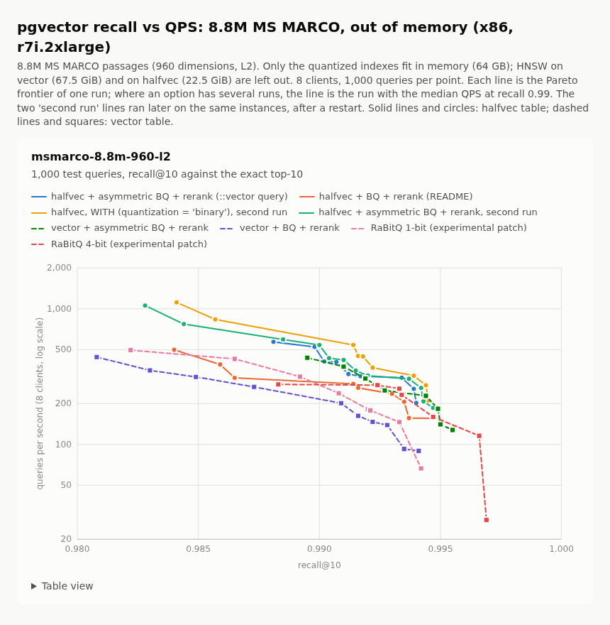

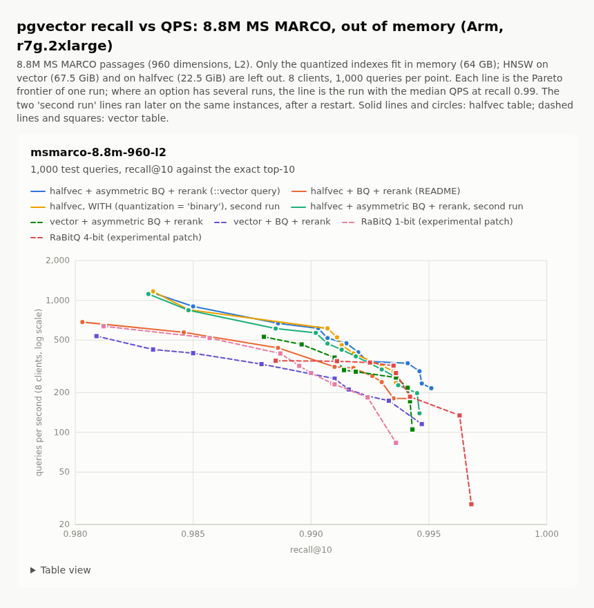

## Part 2: everything in memory

### Setup

- Datasets:
  - dbpedia-openai-1000k-angular (1,536 dimensions). I built it with the ann-benchmarks recipe: 990,000 vectors and 10,000 test queries, `random_state=42`.
  - Cohere 1M (768 dimensions, cosine), from VectorDBBench, with its published neighbors.
  - glove-100-angular (100 dimensions), from ann-benchmarks.
  - nytimes-256-angular (256 dimensions, 290,000 vectors), from ann-benchmarks.
  - dbpedia-openai3-3072-1000k-angular (3,072 dimensions, OpenAI text-embedding-3-large). I built it with the same recipe as DBpedia, from Hugging Face `Qdrant/dbpedia-entities-openai3-text-embedding-3-large-3072-1M`, with exact neighbors. HNSW cannot index a `vector` column with more than 2,000 dimensions, so this dataset has no "HNSW, vector" row. Its vector table uses `STORAGE EXTERNAL`, because a 3,072-dimension vector does not fit in a page.
- Hardware: AWS EC2 r7i.2xlarge (x86) and r7g.2xlarge (Arm), 8 vCPUs and 64 GB each.
- Software: Postgres 18.6. pgvector master (b0665dc) with the [`asymmetric-bq`](https://github.com/txfs19260817/pgvector/tree/asymmetric-bq) branch for the HNSW and subquery rows, and the [`hnsw-quantization`](https://github.com/txfs19260817/pgvector/tree/hnsw-quantization) branch for the `WITH` rows.
- `shared_buffers` is 42 GB, so all tables and indexes stay in memory. I prewarm them with `pg_prewarm` before each sweep. JIT is off.
- One client runs on the same host as the database, and connects over the Unix socket. Queries use binary parameters and prepared statements.
- Each sweep point uses the first 1,000 test queries. Recall@10 is against the exact neighbors.
- HNSW uses the defaults (`m = 16`, `ef_construction = 64`). The tables use `STORAGE PLAIN`, as ann-benchmarks does. Builds use `maintenance_work_mem = 16GB` and 7 parallel workers.
- Each curve is the Pareto frontier of a parameter sweep:
  - HNSW: `ef_search` 10, 20, 40, 80, 120, 200, 400, 800.
  - BQ: `ef_search` 40, 80, 100, 200, 400, 800, 1000, and a rerank count of 10, 20, 40, 80, 100, 200, 400, 800, 1000 (not more than `ef_search`).
- QPS at a recall value comes from the frontier: log-linear interpolation between the two nearest points.

### Queries

| Option | Index | Query |
|---|---|---|
| HNSW | `USING hnsw (embedding halfvec_cosine_ops)` | `ORDER BY embedding <=> $1::halfvec LIMIT 10` |
| BQ + rerank | `USING hnsw ((binary_quantize(embedding)::bit(D)) bit_hamming_ops)` | `SELECT id FROM (SELECT id, embedding FROM items ORDER BY binary_quantize(embedding)::bit(D) <~> binary_quantize($1::halfvec) LIMIT r) c ORDER BY c.embedding <=> $1::halfvec LIMIT 10` |
| Asymmetric BQ + rerank | `USING hnsw ((binary_quantize(embedding)::bit(D)) bit_vector_ip_ops)` | `SELECT id FROM (SELECT id, embedding FROM items ORDER BY binary_quantize(embedding)::bit(D) <#> $1 LIMIT r) c ORDER BY c.embedding <=> $1::halfvec LIMIT 10` |
| `WITH (quantization = 'binary')` | `USING hnsw (embedding halfvec_cosine_ops) WITH (quantization = 'binary')` | `WITH c AS MATERIALIZED (SELECT id, embedding <=> $1::halfvec AS distance FROM items ORDER BY distance LIMIT r) SELECT id FROM c ORDER BY distance + 0 LIMIT 10` |

The vector-table options are the same, with `vector` in place of `halfvec`.

### Build-to-build variation

Two builds of the same BQ index can give different curves at high recall. In my runs, the difference was up to about 40% in QPS. HNSW indexes on the full vectors varied much less. Hamming distance has many ties, and the parallel build adds variation. Thus, I built each BQ index 3 times.

- Each cell is the median of the builds, with the range in parentheses. "Not reached" means that no point of the sweep reached that recall.
- Index size and build time are from the median build.
- A stop and start can move an instance to other hardware. In my runs, that changed the speed of HNSW on halfvec by up to 28%. Thus, a table does not mix sessions on x86:
  - On x86, all options for a dataset ran on one r7i.2xlarge, in one session.
  - On Arm, each dataset ran on its own r7g.2xlarge, with 3 builds of every index. For DBpedia, Cohere and GloVe, the `WITH` rows ran 2 days after the other rows, on the same instance. HNSW on halfvec ran in both sessions: it agreed within 3% on DBpedia and Cohere, and the second session was 8-11% faster on GloVe.

## Part 2 results: x86 (r7i.2xlarge)

QPS at each recall@10. For glove-100-angular and nytimes-256-angular, BQ does not reach high recall, so their tables use lower recall values.

### dbpedia-openai-1000k-angular

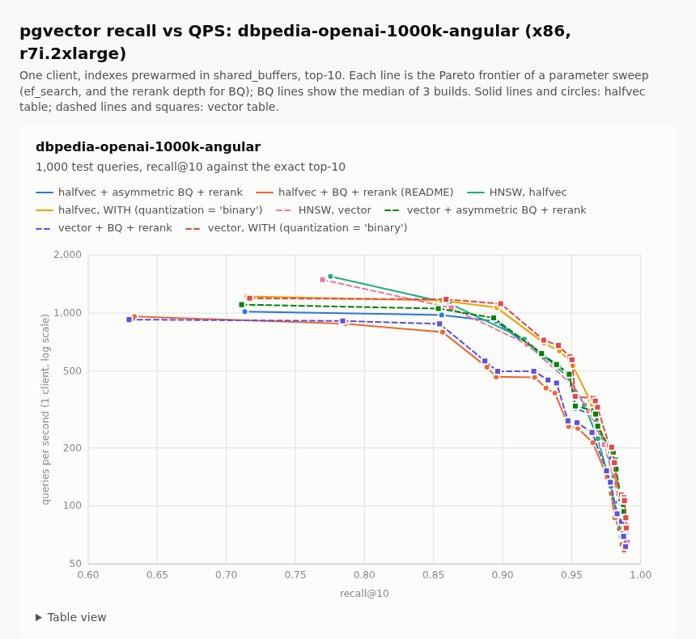

| Option | 0.90 | 0.95 | 0.98 | 0.99 | Best recall@10 | Builds | Index size | Build time |
|---|---|---|---|---|---|---|---|---|
| HNSW, vector | 794 | 427 | 141 | 66 | 0.990 | 1 | 7,734 MB | 279 s |
| HNSW, halfvec | 829 | 438 | 112 | not reached | 0.986 | 1 | 3,867 MB | 219 s |
| BQ + rerank, halfvec | 466 (434-474) | 256 (239-263) | 100 (98-101) | not reached | 0.988 | 3 | 474 MB | 60 s |
| BQ + rerank, vector | 539 (499-553) | 274 (261-282) | 110 (109-115) | not reached | 0.989 | 3 | 474 MB | 63 s |
| Asymmetric BQ + rerank, halfvec | 853 (831-964) | 435 (395-485) | 165 (136-174) | not reached | 0.989 | 3 | 474 MB | 59 s |
| Asymmetric BQ + rerank, vector | 889 (872-935) | 416 (415-428) | 153 (151-190) | not reached | 0.989 | 3 | 474 MB | 59 s |
| `WITH (quantization = 'binary')`, halfvec | 1,021 (1,013-1,030) | 548 (530-563) | 161 (159-195) | not reached | 0.988 | 3 | 474 MB | 60 s |
| `WITH (quantization = 'binary')`, vector | 1,091 (1,024-1,097) | 577 (520-603) | 191 (184-198) | not reached | 0.990 | 3 | 474 MB | 61 s |

### cohere-1m-768-cosine

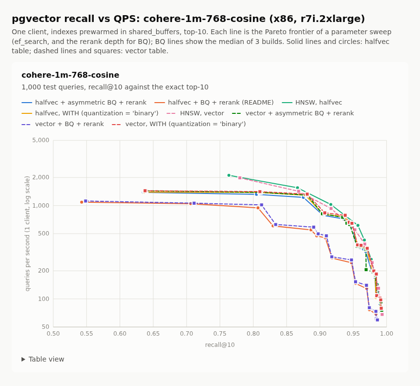

| Option | 0.90 | 0.95 | 0.98 | 0.99 | Best recall@10 | Builds | Index size | Build time |
|---|---|---|---|---|---|---|---|---|
| HNSW, vector | 1,076 | 570 | 219 | 101 | 0.993 | 1 | 3,906 MB | 171 s |
| HNSW, halfvec | 1,176 | 669 | 215 | 90 | 0.991 | 1 | 1,953 MB | 134 s |
| BQ + rerank, halfvec | 475 (464-481) | 195 (193-214) | 73 (72-75) | not reached | 0.987 | 3 | 380 MB | 54 s |
| BQ + rerank, vector | 493 (493-494) | 206 (200-213) | 76 (76-77) | not reached | 0.986 | 3 | 379 MB | 54 s |
| Asymmetric BQ + rerank, halfvec | 844 (830-873) | 536 (469-539) | 182 (182-185) | 89 (84-95) | 0.991 | 3 | 380 MB | 53 s |
| Asymmetric BQ + rerank, vector | 881 (856-888) | 484 (458-499) | 189 (189-192) | 97 (97-101) | 0.993 | 3 | 380 MB | 56 s |
| `WITH (quantization = 'binary')`, halfvec | 877 (727-897) | 572 (368-578) | 186 (179-194) | 94 (93-96), 2 of 3 builds | 0.991 | 3 | 380 MB | 56 s |
| `WITH (quantization = 'binary')`, vector | 948 (874-949) | 570 (560-581) | 192 (190-208) | 102 (101-102) | 0.992 | 3 | 380 MB | 56 s |

### glove-100-angular

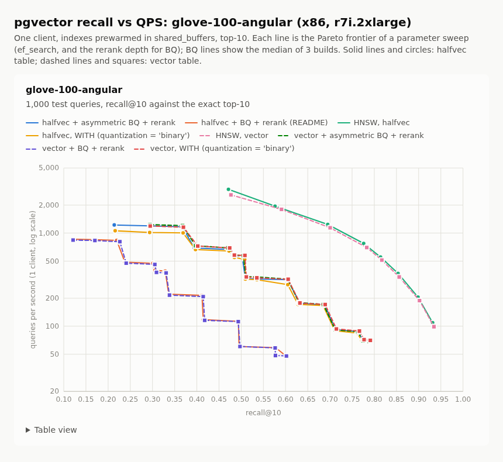

| Option | 0.50 | 0.60 | 0.70 | 0.80 | Best recall@10 | Builds | Index size | Build time |
|---|---|---|---|---|---|---|---|---|
| HNSW, vector | 2,391 | 1,730 | 1,142 | 599 | 0.934 | 1 | 841 MB | 88 s |
| HNSW, halfvec | 2,628 | 1,777 | 1,205 | 626 | 0.931 | 1 | 579 MB | 86 s |
| BQ + rerank, halfvec | 78 (60-103) | 48 (47-49) | not reached | not reached | 0.602 | 3 | 359 MB | 81 s |
| BQ + rerank, vector | 62 (60-62) | 48 (48-49) | not reached | not reached | 0.603 | 3 | 359 MB | 75 s |
| Asymmetric BQ + rerank, halfvec | 581 (569-581) | 316 (309-328) | 123 (121-125) | not reached | 0.787 | 3 | 359 MB | 75 s |
| Asymmetric BQ + rerank, vector | 586 (574-591) | 324 (322-328) | 134 (121-135) | not reached | 0.789 | 3 | 359 MB | 75 s |
| `WITH (quantization = 'binary')`, halfvec | 553 (531-588) | 314 (282-320) | 120 (116-127) | not reached | 0.788 | 3 | 359 MB | 81 s |
| `WITH (quantization = 'binary')`, vector | 577 (575-585) | 321 (312-323) | 124 (120-133) | not reached | 0.788 | 3 | 359 MB | 79 s |

### nytimes-256-angular

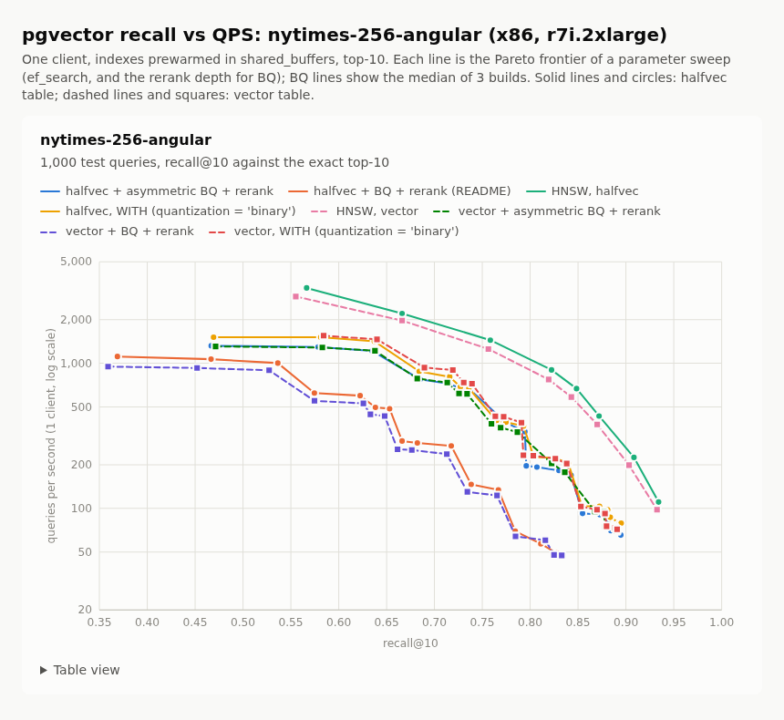

| Option | 0.50 | 0.60 | 0.70 | 0.80 | Best recall@10 | Builds | Index size | Build time |
|---|---|---|---|---|---|---|---|---|
| HNSW, vector | 2,884 | 2,471 | 1,661 | 896 | 0.932 | 1 | 326 MB | 25 s |
| HNSW, halfvec | 3,305 | 2,884 | 1,887 | 1,061 | 0.934 | 1 | 198 MB | 24 s |
| BQ + rerank, halfvec | 1,008 (954-1,036) | 590 (562-610) | 261 (247-276) | 65 (62-71) | 0.828 | 3 | 80 MB | 16 s |
| BQ + rerank, vector | 906 (901-1,081) | 540 (538-644) | 249 (242-277) | 66 (62-74) | 0.831 | 3 | 80 MB | 16 s |
| Asymmetric BQ + rerank, halfvec | 1,523 (1,313-1,608) | 1,452 (1,264-1,534) | 859 (748-962) | 236 (195-315) | 0.894 | 3 | 80 MB | 16 s |
| Asymmetric BQ + rerank, vector | 1,464 (1,301-1,640) | 1,430 (1,263-1,560) | 872 (756-975) | 279 (247-281) | 0.894 | 3 | 80 MB | 16 s |
| `WITH (quantization = 'binary')`, halfvec | 1,512 (1,503-1,755) | 1,479 (1,451-1,701) | 878 (842-1,011) | 311 (268-336) | 0.896 | 3 | 80 MB | 16 s |
| `WITH (quantization = 'binary')`, vector | 1,548 (1,548-1,811) | 1,532 (1,523-1,745) | 921 (909-1,021) | 271 (231-394) | 0.895 | 3 | 80 MB | 16 s |

### dbpedia-openai3-3072-1000k-angular

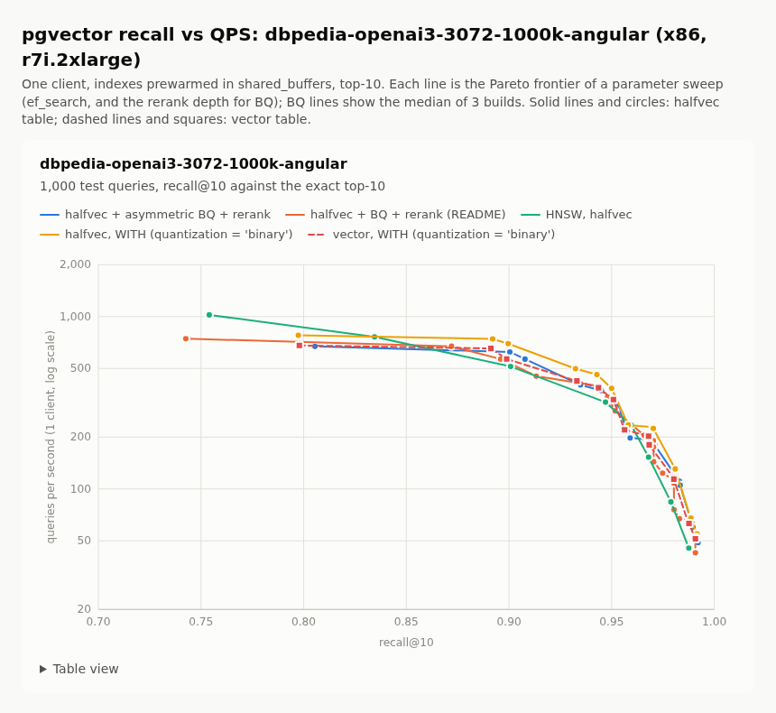

| Option | 0.90 | 0.95 | 0.98 | 0.99 | Best recall@10 | Builds | Index size | Build time |
|---|---|---|---|---|---|---|---|---|
| HNSW, halfvec | 515 | 296 | 78 | not reached | 0.988 | 1 | 7,734 MB | 377 s |
| BQ + rerank, halfvec | 537 (497-551) | 309 (309-324) | 110 (76-113) | 60 (58-60) | 0.992 | 3 | 656 MB | 76 s |
| Asymmetric BQ + rerank, halfvec | 623 (583-623) | 340 (292-356) | 125 (121-125) | 58 (58-61) | 0.992 | 3 | 656 MB | 77 s |
| `WITH (quantization = 'binary')`, halfvec | 657 (646-693) | 384 (373-396) | 137 (127-137) | 61 (61-62) | 0.992 | 3 | 656 MB | 78 s |
| `WITH (quantization = 'binary')`, vector | 562 (499-562) | 336 (259-352) | 117 (107-127) | 54 (49-58) | 0.991 | 3 | 656 MB | 84 s |

## Part 2 results: Arm (r7g.2xlarge)

### dbpedia-openai-1000k-angular

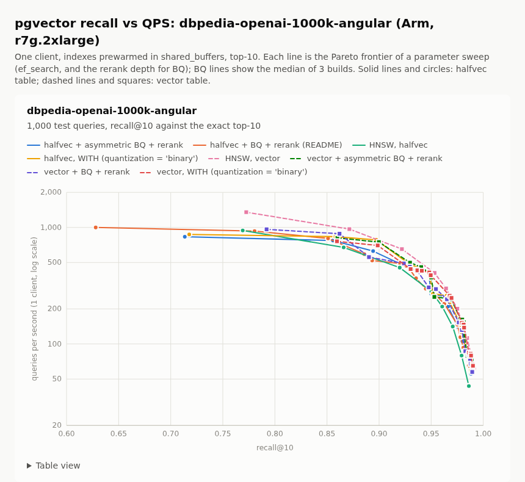

| Option | 0.90 | 0.95 | 0.98 | 0.99 | Best recall@10 | Builds | Index size | Build time |
|---|---|---|---|---|---|---|---|---|
| HNSW, vector | 774 (755-830) | 427 (421-448) | 146 (139-148) | 67 (65-69), 2 of 3 builds | 0.991 | 3 | 7,734 MB | 211 s |
| HNSW, halfvec | 508 (508-523) | 282 (275-283) | 74 (74-77) | not reached | 0.986 | 3 | 3,867 MB | 386 s |
| BQ + rerank, halfvec | 511 (493-513) | 283 (264-297) | 103 (99-104) | not reached | 0.988 | 3 | 474 MB | 56 s |
| BQ + rerank, vector | 536 (401-633) | 302 (227-324) | 123 (102-132) | not reached | 0.989 | 3 | 474 MB | 55 s |
| Asymmetric BQ + rerank, halfvec | 702 (592-724) | 269 (268-302) | 105 (97-117) | not reached | 0.989 | 3 | 474 MB | 56 s |
| Asymmetric BQ + rerank, vector | 746 (566-807) | 371 (268-435) | 148 (97-161) | 59 (54-66) | 0.990 | 3 | 474 MB | 56 s |
| `WITH (quantization = 'binary')`, halfvec | 751 (708-751) | 323 (289-332) | 122 (112-138) | not reached | 0.988 | 3 | 474 MB | 58 s |
| `WITH (quantization = 'binary')`, vector | 697 (687-812) | 385 (378-387) | 148 (112-150) | 66 (65-67), 2 of 3 builds | 0.990 | 3 | 474 MB | 59 s |

### cohere-1m-768-cosine

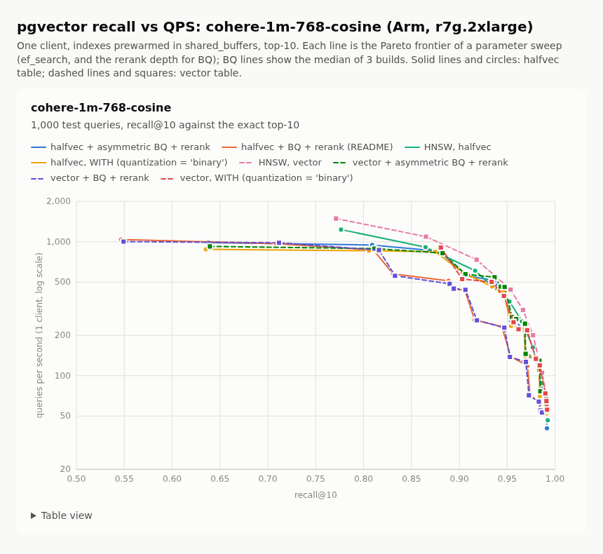

| Option | 0.90 | 0.95 | 0.98 | 0.99 | Best recall@10 | Builds | Index size | Build time |
|---|---|---|---|---|---|---|---|---|
| HNSW, vector | 862 (840-878) | 463 (455-477) | 163 (161-166) | 76 (74-76) | 0.993 | 3 | 3,906 MB | 139 s |
| HNSW, halfvec | 677 (660-691) | 370 (367-376) | 131 (128-134) | 58 (56-62) | 0.992 | 3 | 1,953 MB | 214 s |
| BQ + rerank, halfvec | 415 (409-439) | 170 (166-180) | 63 (61-66) | not reached | 0.987 | 3 | 379 MB | 51 s |
| BQ + rerank, vector | 442 (341-474) | 176 (141-229) | 68 (66-82) | not reached | 0.987 | 3 | 379 MB | 51 s |
| Asymmetric BQ + rerank, halfvec | 549 (522-613) | 331 (321-352) | 130 (126-131) | 66 (66-72) | 0.992 | 3 | 380 MB | 50 s |
| Asymmetric BQ + rerank, vector | 615 (599-630) | 382 (334-387) | 136 (132-136) | 68 (68-73) | 0.992 | 3 | 379 MB | 51 s |
| `WITH (quantization = 'binary')`, halfvec | 592 (468-615) | 321 (316-339) | 131 (126-131) | 65 (64-67) | 0.991 | 3 | 380 MB | 53 s |
| `WITH (quantization = 'binary')`, vector | 566 (492-587) | 338 (314-373) | 134 (132-143) | 68 (67-73) | 0.992 | 3 | 380 MB | 53 s |

### glove-100-angular

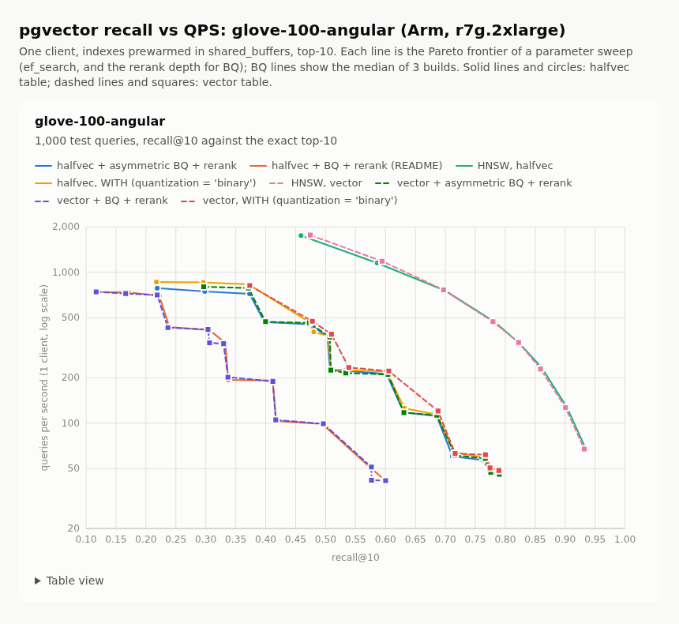

| Option | 0.50 | 0.60 | 0.70 | 0.80 | Best recall@10 | Builds | Index size | Build time |
|---|---|---|---|---|---|---|---|---|
| HNSW, vector | 1,595 (1,531-1,622) | 1,156 (1,067-1,198) | 752 (695-785) | 404 (384-410) | 0.932 | 3 | 841 MB | 87 s |
| HNSW, halfvec | 1,516 (1,377-1,529) | 1,094 (981-1,109) | 726 (622-754) | 388 (334-408) | 0.933 | 3 | 579 MB | 107 s |
| BQ + rerank, halfvec | 54 (52-94) | 42, 1 of 3 builds | not reached | not reached | 0.599 | 3 | 359 MB | 81 s |
| BQ + rerank, vector | 54 (50-96) | 42 (41-42) | not reached | not reached | 0.603 | 3 | 359 MB | 80 s |
| Asymmetric BQ + rerank, halfvec | 384 (379-392) | 212 (212-216) | 84 (79-87) | not reached | 0.790 | 3 | 359 MB | 81 s |
| Asymmetric BQ + rerank, vector | 385 (379-389) | 212 (211-217) | 85 (81-107) | not reached | 0.791 | 3 | 359 MB | 73 s |
| `WITH (quantization = 'binary')`, halfvec | 382 (371-384) | 220 (215-226) | 88 (86-94) | not reached | 0.788 | 3 | 359 MB | 69 s |
| `WITH (quantization = 'binary')`, vector | 392 (362-413) | 215 (212-222) | 91 (74-92) | not reached | 0.789 | 3 | 359 MB | 69 s |

### nytimes-256-angular

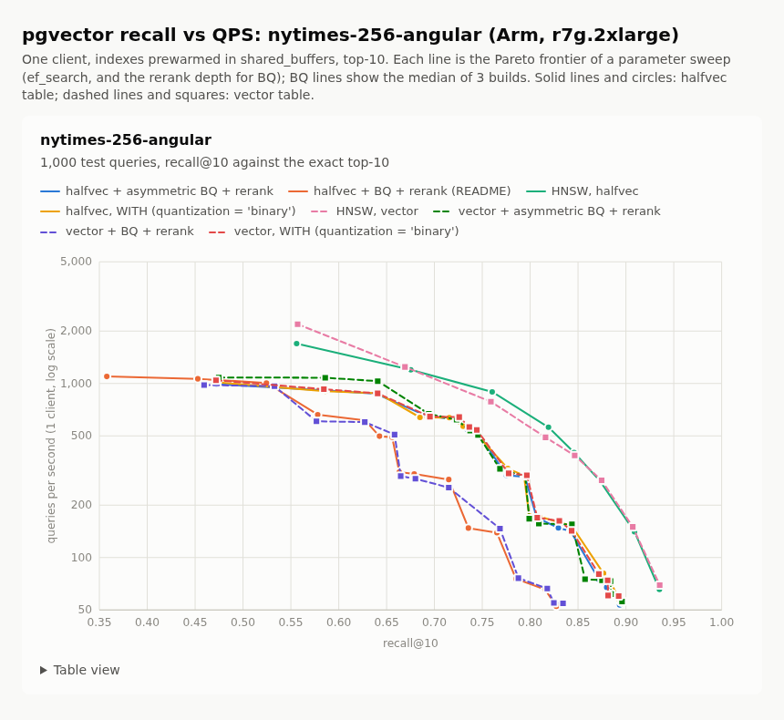

| Option | 0.50 | 0.60 | 0.70 | 0.80 | Best recall@10 | Builds | Index size | Build time |
|---|---|---|---|---|---|---|---|---|
| HNSW, vector | 2,189 | 1,763 | 1,062 | 560 | 0.935 | 1 | 326 MB | 27 s |
| HNSW, halfvec | 1,695 | 1,491 | 1,100 | 652 | 0.935 | 1 | 198 MB | 35 s |
| BQ + rerank, halfvec | 1,025 (958-1,027) | 626 (492-640) | 284 (278-289) | 68 (53-70) | 0.827 | 3 | 80 MB | 16 s |
| BQ + rerank, vector | 971 (952-1,043) | 557 (532-603) | 278 (265-286) | 68 (60-72) | 0.828 | 3 | 80 MB | 15 s |
| Asymmetric BQ + rerank, halfvec | 971 (912-1,060) | 900 (866-1,027) | 606 (573-644) | 227 (220-229) | 0.895 | 3 | 80 MB | 16 s |
| Asymmetric BQ + rerank, vector | 980 (919-1,081) | 969 (878-1,067) | 626 (540-658) | 243 (166-268) | 0.894 | 3 | 80 MB | 15 s |
| `WITH (quantization = 'binary')`, halfvec | 1,063 (986-1,156) | 916 (896-1,108) | 637 (621-668) | 181 (173-263) | 0.895 | 3 | 80 MB | 15 s |
| `WITH (quantization = 'binary')`, vector | 1,032 (1,012-1,118) | 913 (880-1,089) | 597 (594-644) | 193 (158-248) | 0.894 | 3 | 80 MB | 16 s |

### dbpedia-openai3-3072-1000k-angular

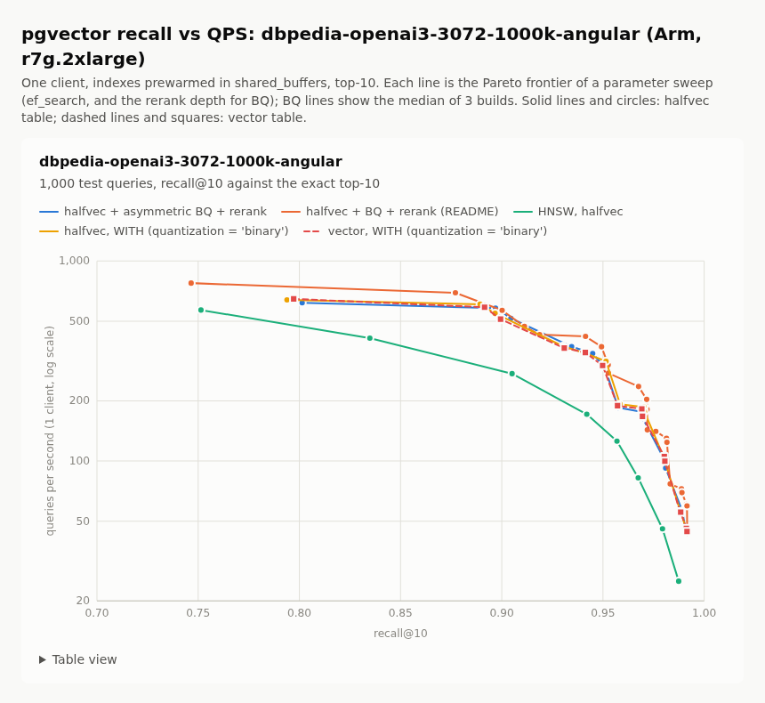

| Option | 0.90 | 0.95 | 0.98 | 0.99 | Best recall@10 | Builds | Index size | Build time |
|---|---|---|---|---|---|---|---|---|
| HNSW, halfvec | 282 | 145 | 44 | not reached | 0.987 | 1 | 7,734 MB | 782 s |
| BQ + rerank, halfvec | 567 (551-607) | 356 (270-358) | 133 (129-139) | 65 (65-72) | 0.992 | 3 | 656 MB | 71 s |
| Asymmetric BQ + rerank, halfvec | 526 (477-554) | 301 (279-313) | 103 (101-103) | 50 (50-54) | 0.992 | 3 | 656 MB | 71 s |
| `WITH (quantization = 'binary')`, halfvec | 583 (527-608) | 319 (299-320) | 105 (101-124) | 50 (50-56) | 0.992 | 3 | 656 MB | 74 s |
| `WITH (quantization = 'binary')`, vector | 492 (488-508) | 296 (263-305) | 106 (105-106) | 50 (45-51) | 0.991 | 3 | 656 MB | 82 s |

## Part 3: writes, everything in memory

### Setup

- The hosts, software and settings are the same as in Part 2, on x86 and Arm.
- Each option has its own table: `id int PRIMARY KEY` and `embedding halfvec(D)` with `STORAGE PLAIN`. The table has only that option's vector index, and autovacuum is off.
- The steps, in order:
  1. Load every training row except the last 50,000, with binary COPY. Then build the index (`maintenance_work_mem = 16GB`, 7 parallel workers).
  2. Run 1,000 test queries.
  3. Insert 10,000 rows with 1 client, then the last 40,000 rows with 8 clients. Each statement inserts one row. During the 8-client inserts, 1 more client runs queries.
  4. Measure recall@10. The table again has every training row, so the dataset's neighbors are correct.
  5. Update 10,000 rows with 1 client, then 40,000 other rows with 8 clients and 1 query client. Each new vector is the row's vector plus 0.25 times the vector of a different row, normalized.
  6. Run `VACUUM (INDEX_CLEANUP ON)`.
  7. Delete the rows with `id % 10 = 0` (10% of the rows). Then run `VACUUM (INDEX_CLEANUP ON)`.
  8. Run 1,000 test queries. Recall@10 is against the exact neighbors of the rows that remain, with their updated vectors.
- Writers use `synchronous_commit = off`, so a commit does not wait for the WAL flush.
- Each write step starts after a `CHECKPOINT`. The WAL values come from `pg_current_wal_lsn()`, so they include full-page images.
- VACUUM uses the default `maintenance_work_mem` (64 MB). The HNSW vacuum code does not use this setting.
- Every option runs at a recall@10 of 0.95 or more. These settings reach that recall in every curve build on both architectures:
  - DBpedia: HNSW `ef_search = 120`. BQ `ef_search = 200`, with a rerank of 40.
  - Cohere: HNSW `ef_search = 80`. BQ `ef_search = 200`, with a rerank of 80.
- Each cell is the median of the runs, with the range in parentheses.

## Part 3 results: x86 (r7i.2xlarge)

### dbpedia-openai-1000k-angular (3 runs)

| Measure | HNSW, halfvec | Asymmetric BQ + rerank |
|---|---|---|
| Index build (s) | 200 (190-201) | 53 (53-53) |
| Index size after the build (MB) | 3,672 (3,672-3,672) | 450 (450-450) |
| Inserts/s, 1 client | 214 (210-214) | 563 (561-565) |
| Inserts/s, 8 clients | 1,170 (1,164-1,177) | 2,780 (2,772-2,794) |
| WAL per inserted row, 8 clients (KB) | 71.5 (71.5-71.6) | 16.3 (16.3-16.3) |
| Updates/s, 1 client | 209 (207-210) | 541 (527-547) |
| Updates/s, 8 clients | 1,098 (1,094-1,098) | 2,471 (2,425-2,497) |
| Query QPS, no writes | 356 (352-364) | 340 (333-359) |
| Query QPS, during 8-client inserts | 250 (248-257) | 238 (237-263) |
| Query QPS, during 8-client updates | 250 (245-252) | 242 (238-262) |
| Query p99 (ms), no writes | 4.4 (4.4-4.4) | 4.4 (4.1-4.6) |
| Query p99 (ms), during 8-client inserts | 11.3 (11.1-11.4) | 9.7 (8.7-10.3) |
| Recall@10 after the inserts | 0.960 (0.958-0.960) | 0.951 (0.951-0.952) |
| VACUUM after 50k updates (s) | 2,104.0 (2,101.7-2,121.3) | 741.4 (739.1-744.0) |
| DELETE 10% of rows (s) | 1.1 (1.1-1.1) | 1.1 (1.1-1.1) |
| VACUUM after the delete (s) | 2,270.1 (2,265.7-2,278.3) | 808.9 (802.4-822.6) |
| WAL written by that VACUUM (MB) | 14,161 (14,143-14,172) | 2,033 (2,033-2,033) |
| Recall@10 after the delete and VACUUM | 0.966 (0.966-0.967) | 0.952 (0.952-0.953) |
| Query QPS after the delete and VACUUM | 335 (329-341) | 336 (324-336) |

### cohere-1m-768-cosine (3 runs)

| Measure | HNSW, halfvec | Asymmetric BQ + rerank |
|---|---|---|
| Index build (s) | 134 (133-136) | 59 (57-61) |
| Index size after the build (MB) | 1,855 (1,855-1,855) | 361 (360-361) |
| Inserts/s, 1 client | 310 (304-311) | 504 (462-524) |
| Inserts/s, 8 clients | 1,568 (1,562-1,602) | 2,489 (2,482-2,499) |
| WAL per inserted row, 8 clients (KB) | 43.1 (43.1-43.1) | 12.5 (12.5-12.5) |
| Updates/s, 1 client | 286 (281-292) | 460 (453-465) |
| Updates/s, 8 clients | 1,507 (1,505-1,532) | 2,316 (2,197-2,459) |
| Query QPS, no writes | 520 (507-542) | 301 (273-314) |
| Query QPS, during 8-client inserts | 340 (330-342) | 226 (210-238) |
| Query QPS, during 8-client updates | 374 (339-380) | 224 (210-224) |
| Query p99 (ms), no writes | 2.8 (2.7-2.9) | 4.7 (4.6-5.0) |
| Query p99 (ms), during 8-client inserts | 8.6 (8.4-8.9) | 10.6 (10.0-11.1) |
| Recall@10 after the inserts | 0.953 (0.951-0.953) | 0.955 (0.954-0.955) |
| VACUUM after 50k updates (s) | 1,652.1 (1,564.4-1,652.9) | 990.0 (907.0-1,010.9) |
| DELETE 10% of rows (s) | 1.0 (1.0-1.0) | 1.0 (1.0-1.1) |
| VACUUM after the delete (s) | 1,643.8 (1,605.8-1,645.3) | 1,017.7 (915.8-1,054.1) |
| WAL written by that VACUUM (MB) | 9,646 (9,575-9,676) | 2,458 (2,449-2,458) |
| Recall@10 after the delete and VACUUM | 0.961 (0.960-0.963) | 0.961 (0.961-0.961) |
| Query QPS after the delete and VACUUM | 504 (477-530) | 262 (245-275) |

## Part 3 results: Arm (r7g.2xlarge)

On Arm, HNSW on halfvec takes 1-2 hours for each VACUUM.

### dbpedia-openai-1000k-angular (3 runs)

| Measure | HNSW, halfvec | Asymmetric BQ + rerank |
|---|---|---|
| Index build (s) | 373 (364-376) | 54 (53-54) |
| Index size after the build (MB) | 3,672 (3,672-3,672) | 450 (450-450) |
| Inserts/s, 1 client | 70 (67-71) | 436 (424-449) |
| Inserts/s, 8 clients | 480 (462-483) | 2,670 (2,660-2,772) |
| WAL per inserted row, 8 clients (KB) | 71.5 (71.5-71.5) | 16.3 (16.3-16.3) |
| Updates/s, 1 client | 71 (70-71) | 407 (405-421) |
| Updates/s, 8 clients | 463 (462-464) | 2,550 (2,487-2,556) |
| Query QPS, no writes | 214 (196-214) | 254 (244-261) |
| Query QPS, during 8-client inserts | 180 (165-181) | 217 (213-221) |
| Query QPS, during 8-client updates | 176 (176-177) | 217 (202-221) |
| Query p99 (ms), no writes | 7.5 (7.5-8.2) | 5.9 (5.8-6.2) |
| Query p99 (ms), during 8-client inserts | 20.4 (19.7-21.3) | 11.2 (10.5-11.3) |
| Recall@10 after the inserts | 0.958 (0.957-0.962) | 0.952 (0.952-0.953) |
| VACUUM after 50k updates (s) | 6,374.1 (6,329.2-6,382.3) | 1,031.9 (1,000.8-1,033.5) |
| DELETE 10% of rows (s) | 1.3 (1.2-1.3) | 1.2 (1.2-1.2) |
| VACUUM after the delete (s) | 6,672.5 (6,647.6-6,718.1) | 1,102.4 (1,053.8-1,119.1) |
| WAL written by that VACUUM (MB) | 19,044 (19,031-19,098) | 2,495 (2,493-2,495) |
| Recall@10 after the delete and VACUUM | 0.966 (0.966-0.967) | 0.952 (0.952-0.952) |
| Query QPS after the delete and VACUUM | 200 (188-200) | 231 (210-238) |

### cohere-1m-768-cosine (3 runs)

| Measure | HNSW, halfvec | Asymmetric BQ + rerank |
|---|---|---|
| Index build (s) | 203 (199-205) | 50 (50-51) |
| Index size after the build (MB) | 1,855 (1,855-1,855) | 361 (360-361) |
| Inserts/s, 1 client | 115 (110-120) | 411 (405-428) |
| Inserts/s, 8 clients | 794 (760-799) | 2,539 (2,448-2,700) |
| WAL per inserted row, 8 clients (KB) | 43.1 (43.1-43.1) | 12.5 (12.5-12.6) |
| Updates/s, 1 client | 105 (101-107) | 367 (355-389) |
| Updates/s, 8 clients | 735 (717-742) | 2,352 (2,206-2,580) |
| Query QPS, no writes | 354 (331-364) | 225 (213-275) |
| Query QPS, during 8-client inserts | 304 (282-308) | 193 (190-212) |
| Query QPS, during 8-client updates | 296 (289-301) | 194 (185-210) |
| Query p99 (ms), no writes | 4.1 (4.0-4.4) | 6.1 (4.8-6.2) |
| Query p99 (ms), during 8-client inserts | 13.2 (12.7-13.5) | 11.9 (10.5-12.0) |
| Recall@10 after the inserts | 0.955 (0.954-0.956) | 0.954 (0.954-0.955) |
| VACUUM after 50k updates (s) | 4,349.4 (4,264.0-4,364.1) | 1,112.0 (1,091.1-1,186.5) |
| DELETE 10% of rows (s) | 1.1 (1.0-1.1) | 1.1 (1.0-1.1) |
| VACUUM after the delete (s) | 4,227.5 (4,208.4-4,244.0) | 1,116.2 (1,009.1-1,188.6) |
| WAL written by that VACUUM (MB) | 15,543 (15,492-15,569) | 2,459 (2,458-2,474) |
| Recall@10 after the delete and VACUUM | 0.963 (0.962-0.965) | 0.961 (0.959-0.961) |
| Query QPS after the delete and VACUUM | 328 (327-350) | 208 (202-221) |

### The current `WITH (quantization = 'binary')` branch: same-session check

The tables above have no `WITH` column, because I measured them on an earlier build of the prototype. These pairs ran the current branch and asymmetric BQ in the same session, one after the other, with a cold start for each. They ran 1-2 days after the tables above, on restarted instances, so compare the two values in a cell, not with the tables above. Each cell is asymmetric BQ / `WITH`, 1 run each (Cohere x86 `WITH`: the median of 3 runs).

| Pair | Inserts/s, 8 clients | Updates/s, 8 clients | WAL per inserted row | VACUUM after the delete | Recall@10 after the delete and VACUUM |
|---|---|---|---|---|---|
| x86, DBpedia | 2,623 / 2,547 | 2,411 / 2,422 | 16.3 / 16.3 KB | 836 / 856 s | 0.952 / 0.953 |
| x86, Cohere | 2,786 / 2,739 | 2,562 / 2,589 | 12.5 / 12.5 KB | 816 / 808 s | 0.960 / 0.960 |
| Arm, DBpedia | 2,640 / 2,564 | 2,434 / 2,266 | 16.3 / 16.3 KB | 1,125 / 1,081 s | 0.952 / 0.952 |
| Arm, Cohere | 2,712 / 2,654 | 2,446 / 2,417 | 12.5 / 12.5 KB | 1,112 / 1,053 s | 0.960 / 0.960 |
